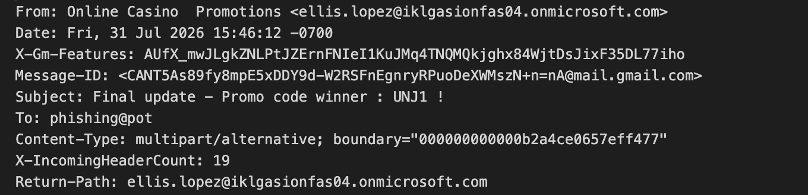
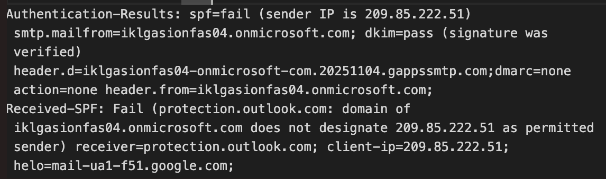
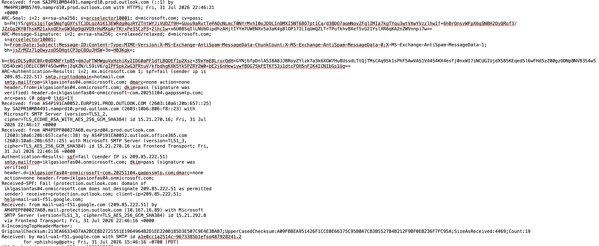
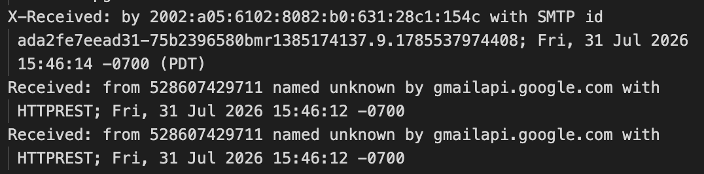
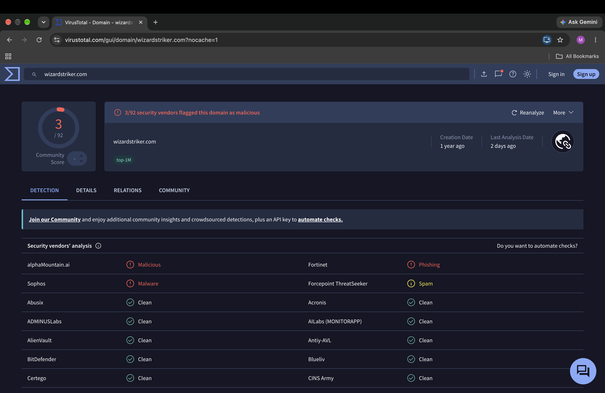
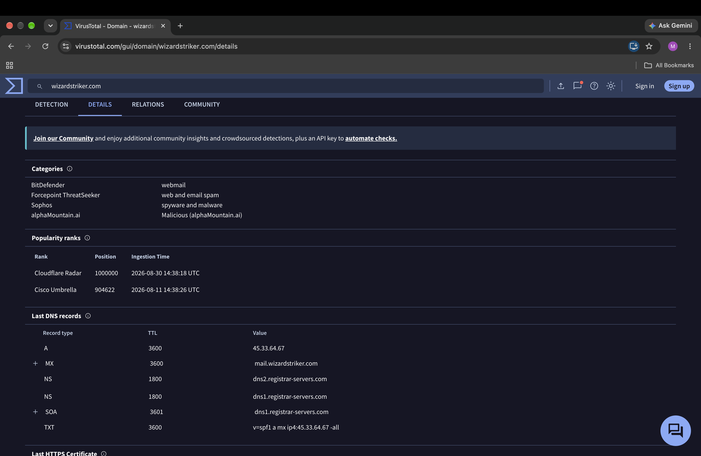
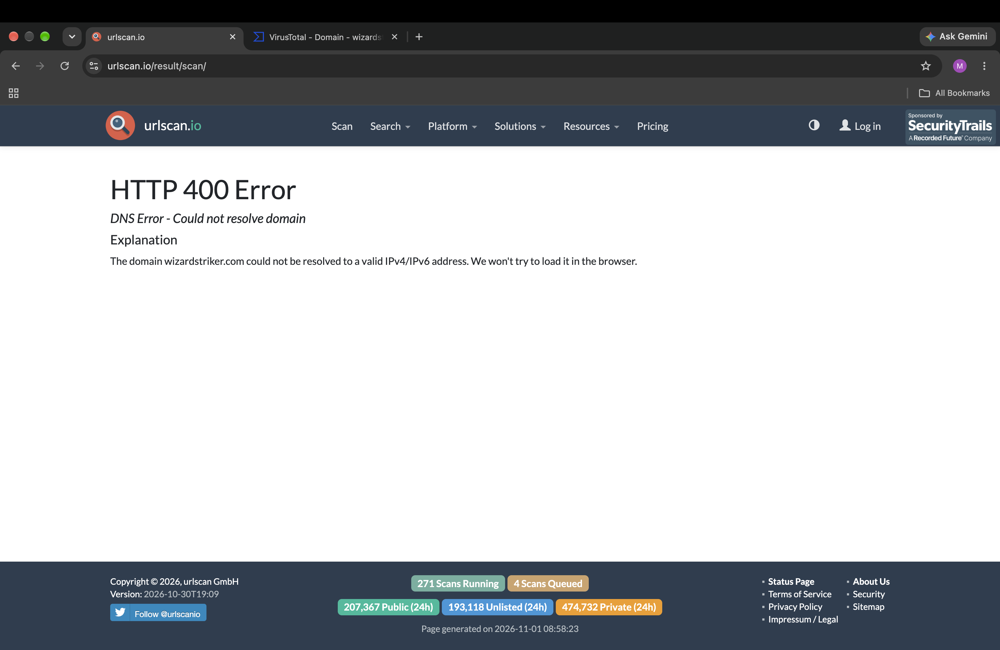
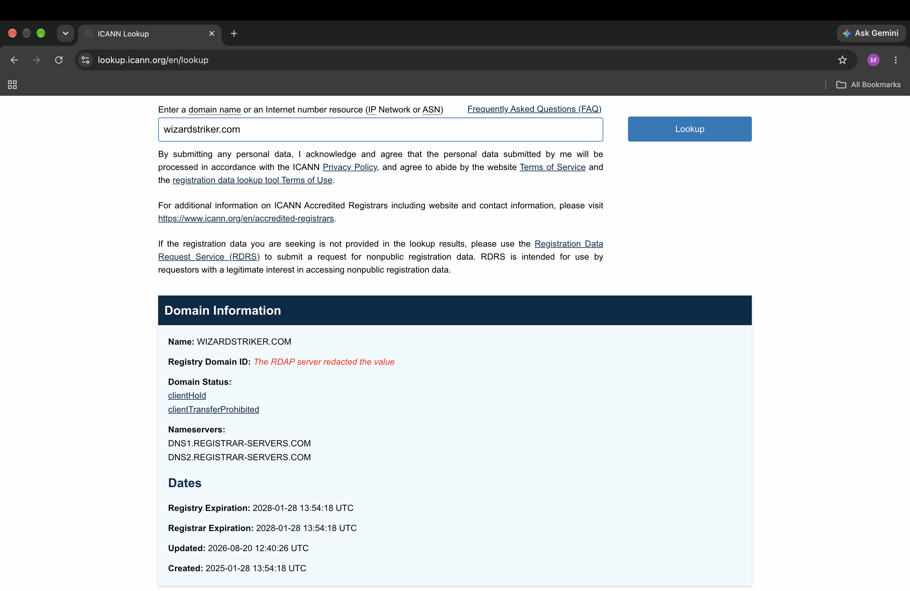
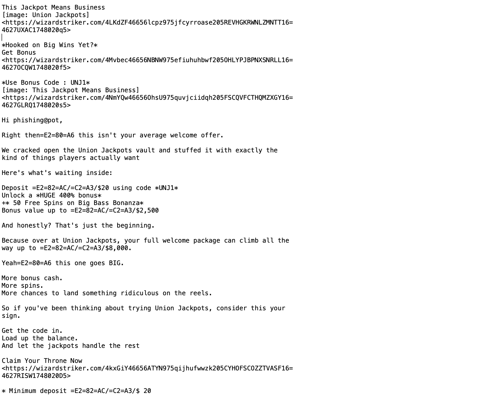

# Case Study 01: Union Jackpots Casino Promotional Email Investigation

| Field | Detail |
|---|---|
| Sample | [Phishing Pot – sample-12.eml](https://github.com/rf-peixoto/phishing_pot/blob/main/email/sample-12.eml) |
| Date of email | 31 July 2026, 15:46:12 -0700 |
| Analyst | Manikanta Rapolu |
| Classification | Suspicious unsolicited promotional spam |
| Severity | Low–Medium |
| Confidence | Moderate – supported by email content, SPF failure, threat-intelligence detections and domain status; malicious activity was not conclusively established. |

## Executive Summary

The investigated email promotes Union Jackpots, an online gambling service, offering a 400% welcome bonus and 50 free spins in exchange for a qualifying deposit. The email directs recipients to multiple URLs hosted on `wizardstriker.com`.

Analysis identified an SPF failure, DKIM success with a different signing domain, a VirusTotal detection ratio of 3/92, and an ICANN `clientHold` status. URLScan could not resolve the domain during investigation. No separate file attachments or confirmed credential theft or malware delivery were identified.

## Email Details

| Field | Value |
|---|---|
| Subject | Final update - Promo code winner : UNJ1 ! |
| From (display name and address) | Online Casino Promotions — ellis.lopez@iklgasionfas04.onmicrosoft.com |
| Return-Path | ellis.lopez@iklgasionfas04.onmicrosoft.com |
| Reply-To | Not present |
| Date | Fri, 31 Jul 2026 15:46:12 -0700 |
| Message-ID | `<CANT5As89fy8mpE5xDDY9d-W2RSFnEgnryRPuoDeXWMszN+n=nA@mail.gmail.com>` (generated by Gmail) |

## Header and Authentication Analysis

| Check | Result | What It Means |
|---|---|---|
| SPF | FAIL | The connecting IP `209.85.222.51` was not authorised by the envelope sender domain's SPF policy. |
| DKIM | PASS | The DKIM signature was successfully verified. However, the signing domain differs from the visible From domain. |
| DMARC | NONE | No applicable DMARC policy/result was reported in the supplied authentication results. |
| Sending infrastructure | Google mail infrastructure | The connecting IP was `209.85.222.51`, with HELO `mail-ua1-f51.google.com`. This IP should not independently be treated as malicious. |
| Mismatch checks | Domain mismatch observed | The visible From domain and envelope sender are `iklgasionfas04.onmicrosoft.com`, while the DKIM signing domain is `iklgasionfas04-onmicrosoft-com.20251104.gappssmtp.com`. |

### Additional header observations

- Seven `Received` header instances were identified.
- One `X-Received` header instance was identified.
- The authentication results show SPF failure and DKIM success simultaneously. These are not contradictory because SPF and DKIM validate different aspects of email authentication.
- DKIM success does not prove that the sender is authorised to represent Union Jackpots.

## Content Analysis

### The lure

The email advertises an online casino welcome promotion under the Union Jackpots brand.

The advertised benefits include:

- 400% welcome bonus.
- 50 free spins on Big Bass Bonanza.
- Promotional code: `UNJ1`.
- Minimum deposit: €20 / £20 / $20.
- Advertised bonus value up to €/£/$2,500.
- Additional welcome package promotion up to €/£/$8,000.

### Urgency or pressure used

The email uses persuasive promotional language, including:

- "This Jackpot Means Business"
- "Hooked on Big Wins Yet?"
- "Claim Your Throne Now"

The message encourages recipients to deposit money and claim the promotional offer.

### Brand or sender impersonation

The message uses Union Jackpots branding and promotional language. However, the supplied evidence does not establish whether the sender is officially authorised by the gambling brand.

The sender uses a Microsoft-hosted domain, while the DKIM signing domain is different from the visible From domain.

This mismatch warrants scrutiny but does not independently prove spoofing.

### Call to action

The recipient is encouraged to:

1. Visit `wizardstriker.com`.
2. Use promotional code `UNJ1`.
3. Deposit at least €20 / £20 / $20.
4. Claim the advertised casino bonuses and free spins.

## Link and Attachment Analysis

| Item | Displayed As | Real Destination (defanged) | Result |
|---|---|---|---|
| Promotional link 1 | Union Jackpots branding image | `hxxps://wizardstriker[.]com/4LKdZF46656lcpz975jfcyrroase205REVHGKRWNLZMNTT164627UXAC1748020q5` | URLScan could not resolve the domain. |
| Promotional link 2 | Get Bonus | `hxxps://wizardstriker[.]com/4Mvbec46656NBNW975efiuhuhbwf205OHLYPJBPNXSNRLL164627OCQW1748020f5` | URLScan could not resolve the domain. |
| Promotional link 3 | Promotional image | `hxxps://wizardstriker[.]com/4NmYQw46656OhsU975quvjciidqh205FSCQVFCTHQMZXGY164627GLRQ1748020s5` | Destination behaviour not verified. |
| Promotional link 4 | Claim Your Throne Now | `hxxps://wizardstriker[.]com/4kxGiY46656ATYN975qijhufwwzk205CYHOFSCOZZTVASF164627RISW1748020D5` | URLScan could not resolve the domain. |
| Image link (unsubscribe position) | Image | `http://wizardstriker[.]com/rd/5IyMye46656sORJ975engsibfwfj205FFCCTEHCLGSLGLP164627BTVI1748020q5` | HTTP destination; behaviour not verified. |

The HTML part of the email contains nine unique links to `wizardstriker[.]com`: the four shown above, plus links labelled "Questions? Contact us 24/7", "LIVE DEALER" and "All Promotions", and one more image link. Every path is different, which is consistent with per-recipient tracking.

**Note:** In the raw plain-text part, long URLs wrap with a trailing `=`. That is a quoted-printable soft line break, not part of the URL. Remove the `=` and join the two lines before recording a URL as an IOC.

### URLScan investigation

URLScan returned:

`HTTP 400 — DNS Error: Could not resolve domain`

The scanner did not load the website. Therefore, the final destination, redirects, page behaviour and possible credential-harvesting activity could not be verified.

### DNS investigation

Google Admin Toolbox Dig returned `Record not found` for:

- A record
- MX record

VirusTotal had previously reported:

- A: `45.33.64.67`
- MX: `mail.wizardstriker.com`
- NS: `dns1.registrar-servers.com`
- NS: `dns2.registrar-servers.com`

The discrepancy may be due to DNS changes or differences in resolver observations. The historical VirusTotal records and later failed lookups should both be preserved in the investigation.

### VirusTotal findings

VirusTotal reported 3 of 92 vendors flagging `wizardstriker[.]com` as malicious.

| Vendor | Label |
|---|---|
| alphaMountain.ai | Malicious |
| Fortinet | Phishing |
| Sophos | Malware |
| Forcepoint ThreatSeeker | Spam (suspicious, not counted in the 3) |

Vendor categories listed: webmail (BitDefender), web and email spam (Forcepoint), spyware and malware (Sophos), malicious (alphaMountain.ai).

The domain also appears in popularity lists (Cisco Umbrella rank 904,622 and a Cloudflare Radar top-1M entry). That means it has had real traffic and is not a freshly created throwaway domain. The labels also differ between vendors, so they point to a risky domain without confirming what the landing page does.

Historical DNS reported by VirusTotal also included an SPF TXT record for the domain (`v=spf1 a mx ip4:45.33.64.67 -all`), which authorises only the domain's own server to send mail for it.

### ICANN registration information

| Field | Result |
|---|---|
| Creation date | 28 January 2025 |
| Updated date | 20 August 2026 |
| Expiration date | 28 January 2028 |
| Domain status | clientHold |
| Additional status | clientTransferProhibited |
| Nameservers | DNS1.REGISTRAR-SERVERS.COM and DNS2.REGISTRAR-SERVERS.COM |

The `clientHold` status generally means the domain is not published in the DNS zone and may not resolve. This may explain the later DNS failures, but the exact cause was not independently established. The domain was created on 28 January 2025, about 18 months before the email was sent. The record was last updated on 20 August 2026, three weeks after the email date, so the hold may have been applied after the campaign, possibly following abuse reports. That is an observation, not a confirmed cause.

### Attachment analysis

The email contains no separate file attachments.

Its MIME structure is `multipart/alternative`, containing:

1. `text/plain`
2. `text/html`

No `Content-Disposition: attachment` headers, filename parameters, or separate binary attachment blocks were identified.

The image references point to externally hosted resources rather than locally attached files.

## Indicators of Compromise (IOCs)

| Type | Value (defanged) | Note |
|---|---|---|
| Domain | `wizardstriker[.]com` | Main promotional domain; flagged by 3 of 92 VirusTotal vendors; registry status clientHold. |
| URL | `hxxps://wizardstriker[.]com/4Mvbec46656NBNW975efiuhuhbwf205OHLYPJBPNXSNRLL164627OCQW1748020f5` | Get Bonus link. |
| URL | `hxxps://wizardstriker[.]com/4kxGiY46656ATYN975qijhufwwzk205CYHOFSCOZZTVASF164627RISW1748020D5` | Claim Your Throne Now link. |
| URL | `http://wizardstriker[.]com/rd/5IyMye46656sORJ975engsibfwfj205FFCCTEHCLGSLGLP164627BTVI1748020q5` | Image link in the unsubscribe position (plain HTTP). |
| IP address | `209.85.222.51` | Google mail infrastructure; do not block solely based on this investigation. |
| IP address | `45.33.64.67` | Historical A record reported by VirusTotal; not confirmed by later DNS checks. |
| Sender address | `ellis.lopez@iklgasionfas04.onmicrosoft.com` | Email sender. |
| DKIM signing domain | `iklgasionfas04-onmicrosoft-com.20251104.gappssmtp[.]com` | Google relay domain that signed the message; does not match the From domain. |
| Subject | `Final update - Promo code winner : UNJ1 !` | Useful email-search indicator. |

**Note:** The table lists the main URLs. Nine unique URLs to the domain exist in the original `.eml` sample. The IP addresses must not be treated as confirmed malicious indicators without additional validation.

Do not block IPs belonging to legitimate providers such as Google or Microsoft solely because they appear in suspicious email headers.

## MITRE ATT&CK Mapping

| Tactic | Technique | Evidence |
|---|---|---|
| Initial Access | T1566.002 – Phishing: Spearphishing Link (potential, not confirmed) | The email contains multiple links encouraging recipients to visit a promotional website. However, credential theft or other phishing behaviour was not established. |

The technique is not recorded as a confirmed attack because the investigation did not establish that the links lead to a malicious destination.

## Risk Assessment

If a recipient interacts with the links, potential risks include:

- Exposure to an unverified gambling website.
- Financial loss through deposits or misleading promotional terms.
- Exposure to tracking or affiliate-marketing mechanisms.
- Potential exposure to malicious content if the destination changes or redirects.

These are potential risks, not confirmed outcomes of this investigation.

No evidence was obtained that recipients entered credentials, downloaded malware, or suffered account compromise.

## Detection Opportunities

### Mail gateway or SIEM detection

- Detect emails containing multiple URLs associated with a single suspicious domain.
- Identify unsolicited gambling promotions and deposit-related language.
- Monitor repeated promotional messages using the same sender or domain.
- Flag large volumes of unusual alphanumeric content in email bodies for further review.

### Authentication monitoring

- Alert on SPF failures.
- Investigate differences between visible From, envelope sender and DKIM signing domains.
- Correlate SPF, DKIM and DMARC outcomes rather than treating one result as definitive proof.

### Threat intelligence monitoring

- Enrich suspicious domains using VirusTotal and DNS intelligence.
- Monitor domain registration and status changes.
- Correlate historical DNS records with current DNS observations.

## Recommended Response

| Action | Detail |
|---|---|
| Contain | Quarantine the message if received in an organisational mailbox. Consider blocking the sender or domain after validating organisational impact and business context. |
| Investigate | Search for other recipients, matching subjects, sender addresses and domain references. Check proxy and DNS logs for evidence of user interaction. |
| Remediate | If a recipient entered credentials, initiate the organisation's credential-reset and account-review process. Investigate any financial activity separately. |
| Prevent | Improve email authentication monitoring, URL filtering, spam detection and user awareness around unsolicited financial promotions. |

Do not block `209.85.222.51` solely because it appears in the email headers.

## 5 Ws Summary

| Field | Answer |
|---|---|
| Time of Activity | 31 July 2026, 15:46:12 -0700, according to the Date header. |
| Affected Entities | The intended recipient was `phishing@pot`. Actual delivery to or interaction by other users was not established. |
| Reason for True Positive | The email is a genuine unsolicited gambling promotion with suspicious characteristics. It is not a confirmed credential-phishing or malware incident. |
| Reason for Escalating | SPF failure, domain reputation detections, multiple promotional URLs and subsequent DNS resolution failures warrant security review. |
| Remediation Actions | Preserve the email, search for similar messages, quarantine where appropriate and monitor for clicks or other user interaction. |
| Attack Indicators | `wizardstriker.com`, sender address, promotional URLs, SPF failure and VirusTotal detections. |

## Evidence

Screenshots stored in `Evidence/Case_01/`.

**1. Sender, recipient, subject, date and Return-Path** (`01_Sender_Details.png`)

**2. SPF, DKIM, DMARC and Received-SPF results** (`02_Authentication_Results.png`)

**3. Email routing from the Received and X-Received headers** (`03A_Received_Chain.png`, `03B_Received_Chain.png`)

**4. VirusTotal detection ratio** (`04_VirusTotal_Detection.png`)

**5. VirusTotal categories and historical DNS records** (`05_VirusTotal_Domain_Details.png`)

**6. URLScan DNS error** (`06_DNS_URLScan_Results.png`)

**7. ICANN domain registration data** (`07_ICANN_Domain_Registration.png`)

**8. Email body: Union Jackpots branding, offer, bonus code, links and deposit requirement** (`08_Email_Body_Content.png`)

## Lessons Learned

1. Email authentication results must be interpreted together. SPF failure does not automatically prove spoofing, and DKIM success does not establish sender legitimacy.
2. A known mail-provider IP should not be blocked without evidence that the infrastructure itself is malicious.
3. A low VirusTotal detection ratio does not guarantee that a domain is safe.
4. DNS information can change. Historical threat-intelligence results must be compared with current DNS observations.
5. URLScan DNS failures do not prove that a domain is malicious or harmless.
6. A promotional email requesting deposits should be assessed for financial risk, misleading claims and possible malicious links.
7. MIME analysis is important for identifying attachments. An email containing HTML and external image links does not necessarily contain file attachments.
8. An analyst must distinguish confirmed observations from assumptions and avoid claiming malware or credential theft without supporting evidence.
9. Raw email text is often quoted-printable encoded. A trailing `=` is a line break, and sequences such as `=E2=82=AC` are encoded characters (here, the euro sign). Decode before recording indicators.

### Final Conclusion

Case Study 01 was investigated as an unsolicited Union Jackpots casino promotional email.

The investigation identified suspicious characteristics, including an SPF failure, limited VirusTotal detections, multiple links to the same domain and an ICANN `clientHold` status. However, URLScan could not load the destination, and no evidence confirmed credential theft, malware delivery or malicious redirects.

**Final classification: Suspicious unsolicited promotional spam.**

**Severity: Low–Medium.**

**Confidence: Moderate.**

**Investigation status: Completed — findings documented.**
