# Case Study 02: Fake Ledger Data Breach Email Asking for a Recovery Phrase

| Field | Detail |
|---|---|
| Sample | [Phishing Pot sample-6413](https://github.com/rf-peixoto/phishing_pot) |
| Date of email | 19 January 2025 |
| Analyst | Manikanta Rapolu |
| Classification | Phishing: recovery (seed) phrase harvesting, impersonating Ledger |
| Severity | High potential impact. No evidence in this sample that any recipient entered a phrase |
| Confidence | High for the classification. The landing page could not be recovered |

## Executive Summary

The email claims that a data breach may have exposed Ledger wallet recovery phrases and tells the recipient to verify theirs on an "official verification page". The sender name says "Ledger Recovery", but the sending domain is `recovery.com`, an unrelated established business, not a Ledger domain. The message was sent through SendGrid, so SPF and DKIM pass for `sendgrid.net` while DMARC fails for the visible From domain. The only link points to a page in an Amazon S3 bucket. Five of 93 VirusTotal vendors label that URL as phishing, and the bucket no longer exists. A recovery phrase gives full control of a wallet, and Ledger states that it never asks for it.

## Email Details

| Field | Value |
|---|---|
| Subject | Data Breach – Check Your Recovery Phrase (the dash is MIME-encoded in the header) |
| From | Ledger Recovery, `noreply@recovery[.]com` |
| Return-Path | `bounces+14379695-8d6a-<recipient>@sendgrid[.]net` |
| Reply-To | Not present |
| Date | Sun, 19 Jan 2025 14:53:52 +0000 |
| Message-ID | `<20250119145352.607733919C907DBD@recovery.com>` |
| Sending IP | 159.183.224.100 |
| Format | HTML only (quoted-printable), no plain-text alternative, no attachment |

## Header and Authentication Analysis

| Check | Result | What It Means |
|---|---|---|
| SPF | Pass, for `sendgrid.net` | The sending IP is authorised for SendGrid's bounce domain, not for `recovery.com` |
| DKIM | Pass, signed by `sendgrid.net` | The signature is valid but belongs to SendGrid, not to the From domain |
| DMARC | Fail for `recovery.com`, action none | SPF and DKIM do not align with the From domain, but no enforcement happened, so the email was delivered |
| Sending infrastructure | SendGrid (`s.wfbtzhsq.outbound-mail.sendgrid.net`) | An email marketing platform was used to send the message |
| Mismatch checks | Brand in the display name, unrelated domain in the address | The From domain is not a Ledger domain |

### Additional header observations

- The first Received hop shows a client identifying itself as `recovery.com` handing the message to a SendGrid server (`geopod-ismtpd`), so a SendGrid customer account sent it.
- The DKIM selector is `smtpapi`, and the headers include SendGrid-specific fields (`X-SG-EID`, `X-Entity-ID`). Together they indicate the message was submitted through SendGrid's mail API.
- The number `14379695` in the bounce address appears to identify the SendGrid sender account. That is the detail a SendGrid abuse report would need.
- The subject contains a MIME encoded word (`=?UTF-8?B?4oCT?=`), which decodes to an en dash. It is not a hidden character trick.
- The delivery chain runs SendGrid, then Microsoft Exchange Online Protection, then the recipient mailbox, in about four seconds.

**Note:** Passing SPF and DKIM does not make an email legitimate. Both can pass for a platform such as SendGrid while the visible From domain is unrelated. DMARC alignment is the check that compares them.

## Content Analysis

### The lure

A notice of a data breach that may have exposed recovery phrases.

### Urgency or pressure used

It says the wallet remains secure but that phrases "may have been exposed", and that it is "crucial" to verify the phrase using a "secure verification tool". Reassurance and fear are combined.

### Brand or sender impersonation

The Ledger logo is loaded from Ledger's own image host, so the email looks genuine when images load. The greeting is generic ("Dear Customer"), and the From domain is unrelated to Ledger.

### Call to action

A button labelled "Verify My Recovery Phrase" and a numbered list telling the recipient to visit an "official verification page".

## Link and Attachment Analysis

There is no attachment and no form in the email. It contains one link.

| Item | Displayed As | Real Destination (defanged) | Result |
|---|---|---|---|
| Button | Verify My Recovery Phrase | `hxxps://recovery-support[.]s3[.]eu-north-1[.]amazonaws[.]com/recovery[.]html` | 5 of 93 vendors flag it as phishing. Now returns 404 |
| Logo image | Ledger Logo | Ledger's own website image host | Legitimate asset, hotlinked |

The destination is a page in an Amazon S3 bucket, not a Ledger domain. Hosting on a major cloud provider gives attackers a trusted-looking domain, and it means the provider's domain cannot be blocked without affecting legitimate sites.

**Note:** In the raw HTML the link wraps across two lines with a trailing `=` (a quoted-printable soft line break). The real URL ends in `recovery.html`.

### VirusTotal findings for the URL

VirusTotal reported 5 of 93 vendors flagging the URL, all as phishing.

| Vendor | Label |
|---|---|
| BitDefender | Phishing |
| Forcepoint ThreatSeeker | Phishing |
| Fortinet | Phishing |
| G-Data | Phishing |
| Sophos | Phishing |

Sophos categorises it as "phishing and fraud" and Forcepoint as "phishing and other frauds". On 6 November 2026 the page returned HTTP 404 from AmazonS3 with a 326-byte XML body, so it is no longer being served.

The URL was first submitted to VirusTotal on 19 January 2025 at 14:47:28 UTC, 6 minutes 24 seconds before the email was accepted by SendGrid. That fits an attacker or automated feed checking the link before sending, but a first submission alone does not prove who submitted it or whether the page was live.

### urlscan investigation

urlscan.io had no earlier scan of the bucket hostname. A new scan was run on 6 November 2026 and returned an S3 XML error saying the specified bucket does not exist. urlscan gave no classification, and Google Safe Browsing had none either. The scan targeted the bucket root rather than `recovery.html`, but a missing bucket means every path inside it fails, which matches the 404 that VirusTotal recorded for the exact URL. The page content therefore could not be recovered.

### Sender domain investigation

`recovery.com` is not a Ledger domain, so the email used a borrowed domain name.

| Source | Finding |
|---|---|
| VirusTotal | 0 of 92 vendors flag it. Categories include health and medicines, healthcare, and financial data and services |
| Popularity lists | Present in Cloudflare Radar, Cisco Umbrella, and Majestic rankings |
| ICANN | Created 23 April 1999, about 25.7 years old at the time of the email. Client lock statuses set. Cloudflare name servers |

This is an established, apparently legitimate business whose domain name was used in the From address. It is not the attacker's infrastructure and should not be blocked at the web proxy. VirusTotal also shows two detected files communicating with the domain, which was not investigated and does not change the conclusion.

### Attachment analysis

None. The email is a single HTML part.

## External Corroboration

Public reporting describes a Ledger phishing campaign of the same type: an email announcing a data breach, sent through SendGrid, asking the recipient to verify their recovery phrase on a page that then requests the 12, 18, or 24 words.

- BleepingComputer: https://www.bleepingcomputer.com/news/security/new-fake-ledger-data-breach-emails-try-to-steal-crypto-wallets/
- Cointelegraph: https://cointelegraph.com/news/ledger-support-email-spoofed-fake-data-breach-phishing-link
- Ledger's own warning page: https://www.ledger.com/phishing-campaigns-status

Those reports are from December 2024 and describe a different sender address and subject, so this sample (19 January 2025) is a later variant of the same theme. Ledger states that it never asks for a recovery phrase and that it should only ever be entered on the device itself.

## Timeline (UTC)

| Time | Event |
|---|---|
| 2025-01-19 14:47:28 | The phishing URL is first submitted to VirusTotal |
| 2025-01-19 14:53:52 | SendGrid accepts the message from a client identifying as `recovery.com` |
| 2025-01-19 14:53:53 | The message reaches Microsoft's front-end mail servers |
| 2025-01-19 14:53:56 | The final delivery hop completes |
| 2026-11-06 | The S3 bucket no longer exists and the URL returns 404 |

## Indicators of Compromise (IOCs)

| Type | Value (defanged) | Note |
|---|---|---|
| URL | `hxxps://recovery-support[.]s3[.]eu-north-1[.]amazonaws[.]com/recovery[.]html` | Phishing page |
| Hostname | `recovery-support[.]s3[.]eu-north-1[.]amazonaws[.]com` | A specific S3 bucket. Do not block `amazonaws.com` as a whole |
| Sender address | `noreply@recovery[.]com` | Borrowed domain, not a Ledger domain |
| Subject | Data Breach – Check Your Recovery Phrase | Useful for a mail search |
| Message-ID | `<20250119145352.607733919C907DBD@recovery.com>` | Message identifier |
| Bounce address | `bounces+14379695-8d6a-<recipient>@sendgrid[.]net` | The number appears to identify the SendGrid sender account |
| Sending IP | 159.183.224.100 | SendGrid infrastructure. Do not block |
| DKIM domain | `sendgrid[.]net` | Legitimate platform. Do not block |
| S3 serving IPs | 3.5.217.236, 16.12.11.38 | Shared Amazon infrastructure. Do not block |

**Note:** Block the specific URL or bucket hostname and the sender address. Do not block SendGrid or Amazon addresses, and do not block `recovery.com` as a website, because large amounts of legitimate mail and traffic use them.

## MITRE ATT&CK Mapping

| Tactic | Technique | Evidence |
|---|---|---|
| Initial Access | T1566.002 Phishing: Spearphishing Link | Link-based lure impersonating a brand |
| Reconnaissance | T1598.003 Phishing for Information: Spearphishing Link | The link leads to a page that collects a secret (the recovery phrase) |

## Risk Assessment

A recovery phrase gives complete control of every account created from it. Anyone who enters it on the fake page loses their wallet funds, and cryptocurrency transfers cannot be reversed. The direct victims are individuals, but a SOC would still treat it as brand abuse and a risk for any employee who uses a personal wallet on a work device.

## Detection Opportunities

### Mail gateway or SIEM detection

- Alert when DMARC fails for the From domain and the display name contains a well-known brand that does not match the domain
- Flag mail relayed through an email marketing platform where the From domain is unrelated to the brand named in the display name
- Match keywords such as "recovery phrase", "seed phrase", and "24 words" in inbound mail

### Network and proxy monitoring

- Block the known phishing URL and bucket hostname
- Watch for cloud-storage hosted HTML pages impersonating brands

## Recommended Response

| Action | Detail |
|---|---|
| Contain | Block the URL and bucket hostname and the sender address, and remove the email from all mailboxes |
| Investigate | Search mail logs for the subject and sender, and proxy and DNS logs for the bucket hostname, to find any recipient who clicked |
| Remediate | If anyone entered a phrase, they must move their funds to a new wallet with a new phrase immediately. The old phrase can never be made safe |
| Prevent | Report the sending account to SendGrid abuse (using the account number above) and the bucket to Amazon abuse if it is ever recreated. Remind users that no legitimate wallet provider asks for a recovery phrase |

## 5 Ws Summary

| Field | Answer |
|---|---|
| Time of Activity | 19 January 2025, around 14:53 UTC |
| Affected Entities | The recipient mailbox. Other recipients are unknown |
| Reason for Classification | Brand impersonation, a request for a recovery phrase, DMARC failure for an unrelated From domain, delivery through an email platform, 5 of 93 vendors labelling the link as phishing, and a match with publicly reported campaigns |
| Reason for Escalating | The email targets a secret that gives full, irreversible control of funds |
| Remediation Actions | Block URL and sender, remove from mailboxes, check logs for clicks, report to the sending platform |
| Attack Indicators | recovery-support[.]s3[.]eu-north-1[.]amazonaws[.]com, noreply@recovery[.]com |

## Limitations

- The landing page could not be recovered, because the S3 bucket no longer exists. The report therefore cannot say exactly what the page displayed. Public reporting on the same campaign says the page asks for the recovery phrase.
- The urlscan scan was public and targeted the bucket root, not the full path.
- No archived copy of the page was searched for.
- No evidence in this sample shows whether any recipient clicked.

## Evidence

Screenshots stored in `Evidence/Case_02/`.

**1. Sender, subject, date, Message-ID and Return-Path** (`01_Sender_Details.png`)

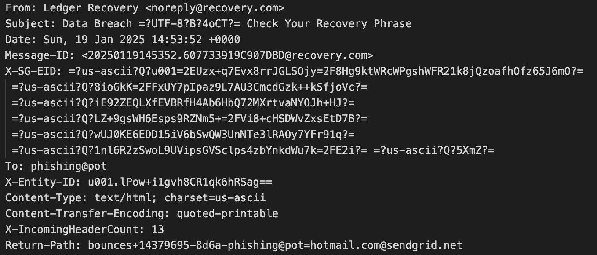

**2. SPF, DKIM and DMARC results** (`02_Authentication_Results.png`)

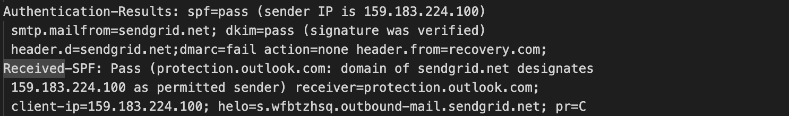

**3. SendGrid hop and DKIM signature** (`03_SendGrid_Origin_and_DKIM.png`)

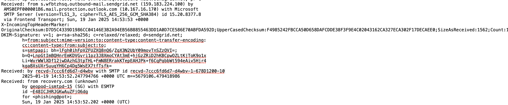

**4. Microsoft delivery hops** (`04_Received_Chain_Microsoft.png`)

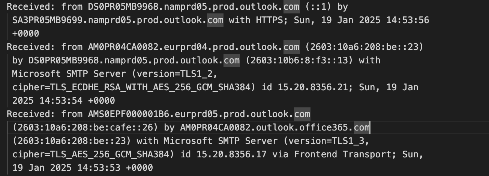

**5. Email body HTML with the link** (`05_Email_Body_HTML.png`)

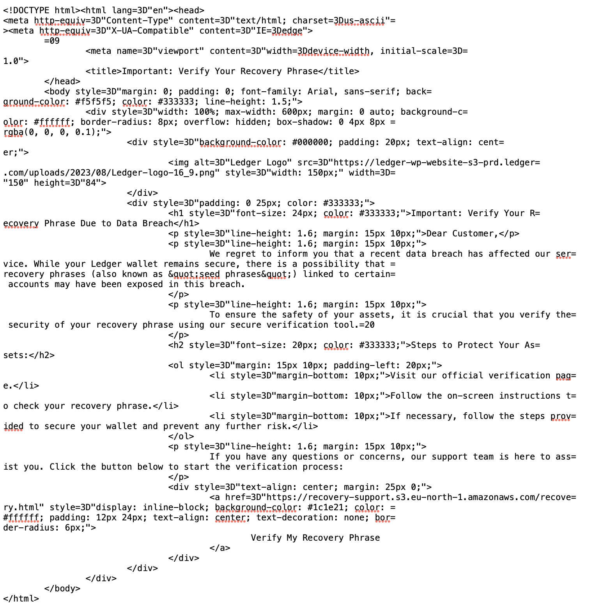

**6. VirusTotal URL detections** (`06_VirusTotal_URL_Detection.png`)

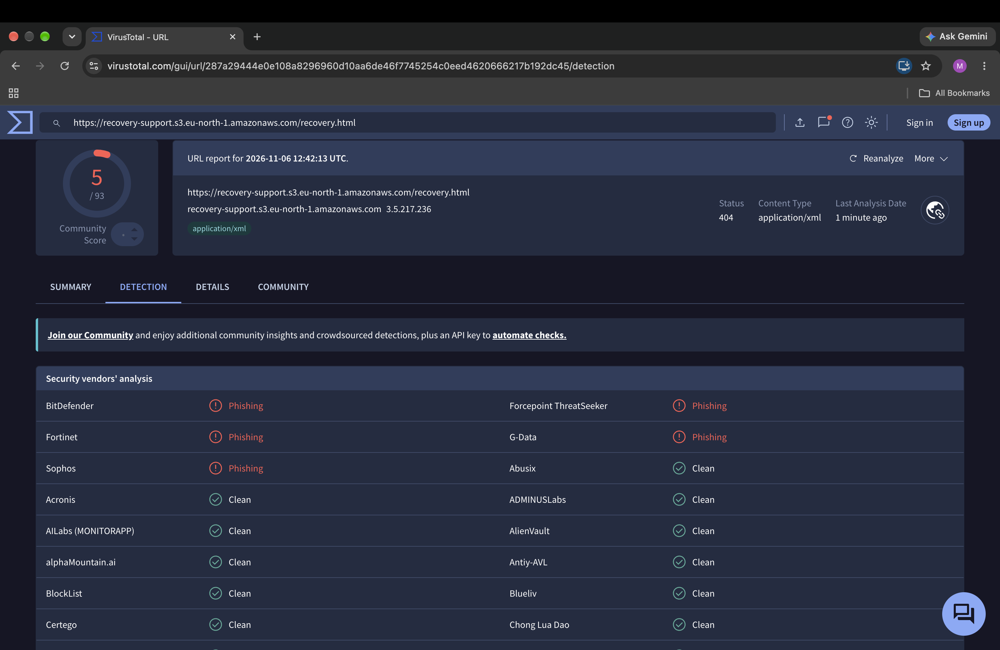

**7. VirusTotal URL details, history and HTTP response** (`07_VirusTotal_URL_Details.png`)

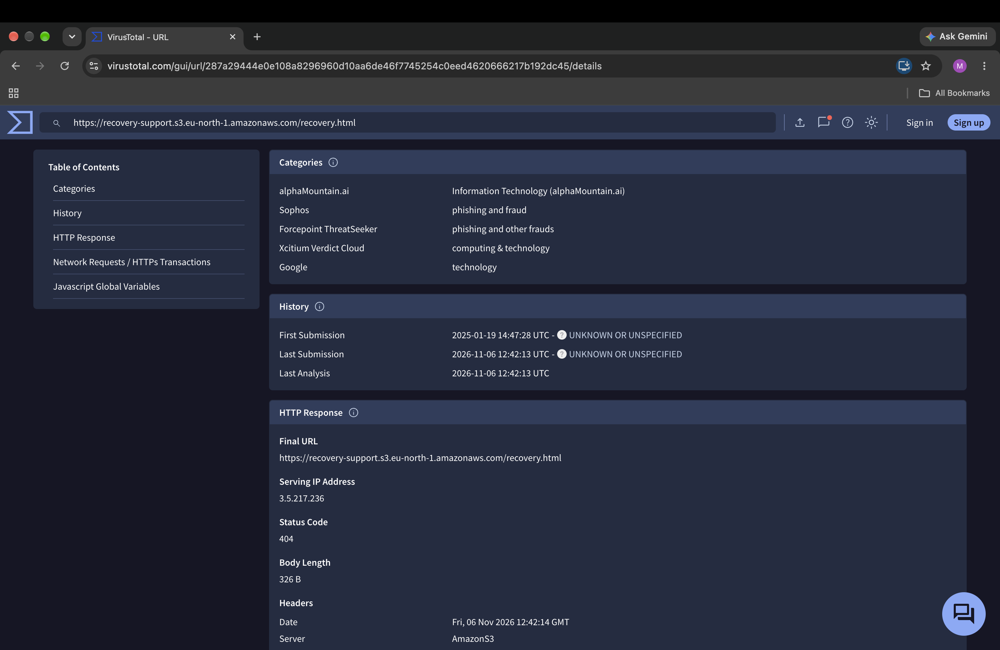

**8. VirusTotal detections for recovery.com** (`08_VirusTotal_Domain_recovery_com_Detection.png`)

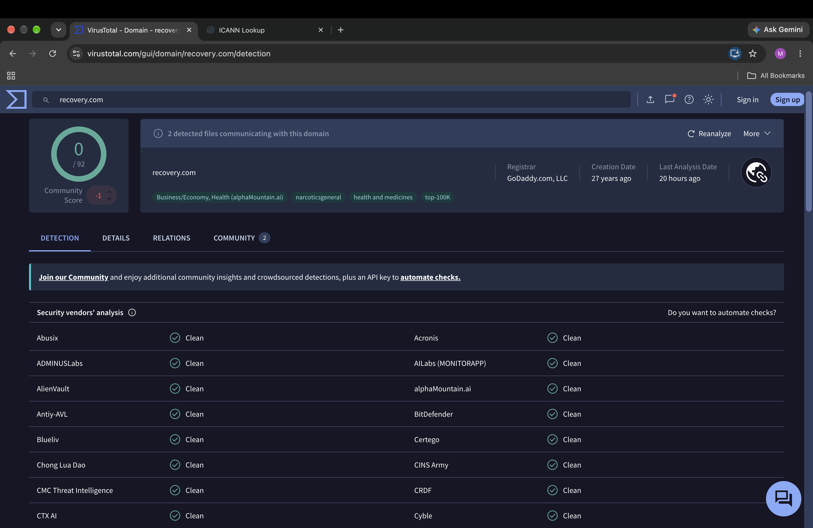

**9. VirusTotal details for recovery.com** (`09_VirusTotal_Domain_recovery_com_Details.png`)

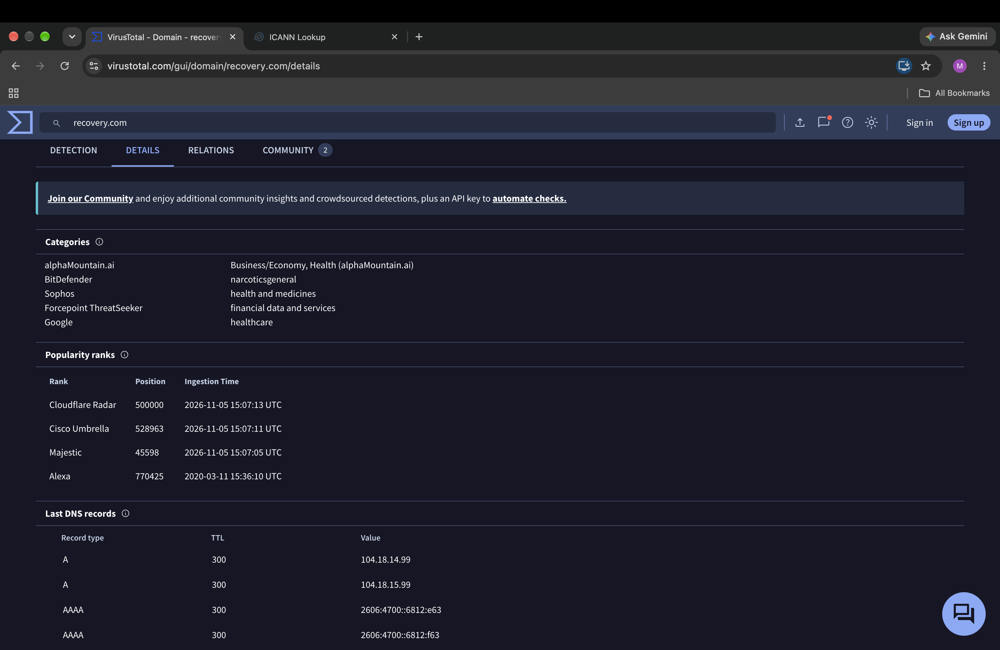

**10. ICANN registration data for recovery.com** (`10_ICANN_recovery_com.png`)

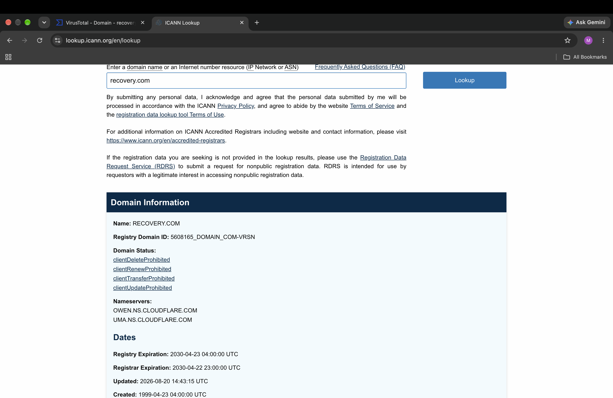

**11. urlscan result showing the missing bucket** (`11_URLscan_Result.png`)

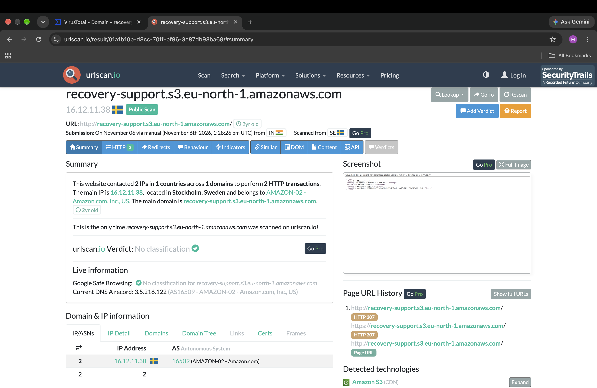

## Lessons Learned

1. SPF and DKIM passing is not the same as the email being trustworthy. Compare the authenticated domain with the visible From domain.
2. Attackers rent legitimate infrastructure (SendGrid, Amazon S3) and borrow real business names, so the right response is to block the specific URL and sender, not the platform or the borrowed domain.
3. Phishing pages disappear quickly. Record the evidence early, and use reputation history and public reporting when the page is gone.
4. A first-seen timestamp can show when a URL entered the threat-intelligence ecosystem, but it does not by itself show intent.
5. Public scans are visible to everyone. In a real investigation, use unlisted or private scans so an internal or sensitive URL is not exposed.
